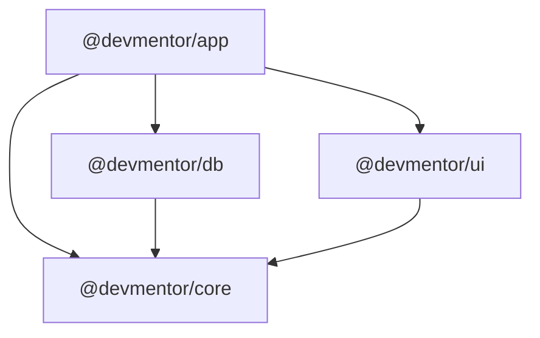

# DevMentor

DevMentor is a web application built on Next.js, React and TypeScript, backed by PostgreSQL.

## Tech stack

| Concern | Technology |
|---|---|
| Framework | [Next.js](https://nextjs.org) (App Router), [React](https://react.dev), [TypeScript](https://www.typescriptlang.org) |
| Database | [PostgreSQL](https://www.postgresql.org) |
| ORM & migrations | [MikroORM](https://mikro-orm.io) v7 |
| Dependency injection | [Awilix](https://github.com/jeffijoe/awilix) |
| Frontend (public) styling | [Tailwind CSS](https://tailwindcss.com) |
| Backend (admin) UI | [shadcn/ui](https://ui.shadcn.com) (Base UI) |
| Monorepo | npm workspaces |

## Architecture

### Monorepo packages

```
packages/
├── app/    @devmentor/app   Next.js application (routes, pages, feature modules, DI container)
├── core/   @devmentor/core  Reusable, framework-agnostic code (domain types, errors, utilities)
├── db/     @devmentor/db    MikroORM config, entities, repositories, migrations
└── ui/     @devmentor/ui    Reusable React components (shadcn/ui primitives + frontend components)
```

Dependencies only point "downwards", so there are no cycles:



- **core** has no dependencies on other packages and no framework code.
- **db** and **ui** may use **core** only.
- **app** puts everything together and is the only package that knows about all the others.
- `npm run lint` enforces these rules (root `eslint.boundaries.mjs`).

Domain code is organised by concept (`bookings`, `mentors`, ...), using the same folder name in each layer that needs it. The full naming, placement, security and review rules are in [`.ai/docs/engineering-standards.md`](.ai/docs/engineering-standards.md).

### Application (`packages/app`)

- Uses the Next.js App Router, split into two route groups:
  - `(frontend)`: public pages, styled with Tailwind.
  - `(backend)/admin`: admin pages, built with shadcn/ui.
- Business logic lives in feature modules (`src/modules/<concept>`). Pages, route handlers and server actions stay thin and delegate to services.
- Every API route is wrapped in `apiHandler`. Services throw typed errors from `@devmentor/core` (`NotFoundError`, `ValidationError`, ...), and responses share one envelope: `{ ok: true, data }` or `{ ok: false, error: { code, message } }`. In the browser, `/api/*` is called only through `apiCall` from `@devmentor/ui`.
- `GET /api/health` reports whether the app can reach the database: `200 {"ok":true,"data":{"status":"ok","db":"ok"}}` when healthy, and `503` with error code `database_unavailable` when not.

### Dependency injection

- Awilix builds the dependency container in one place (`packages/app/src/di/container.ts`).
- Long-lived objects are **singletons**, such as the MikroORM instance and configuration.
- Each request gets its own **scope**, containing a forked MikroORM `EntityManager` plus the repositories and services that use it. This keeps database state isolated between requests.

### Data layer

- PostgreSQL is accessed through MikroORM, with connection pooling configured centrally in `packages/db`.
- All schema changes go through versioned, committed MikroORM migrations.

### UI

- `packages/ui` contains the shadcn/ui primitives used by admin pages (`src/components/ui`), shared admin building blocks such as `apiCall` and the loading/error/empty states (`src/backend`), and the custom Tailwind components used by public pages (`src/frontend`).
- Components are presentational: they receive data through props and never fetch it themselves.

## Getting started

Requires Node.js 22.17 or newer, and Docker (or any PostgreSQL instance).

```bash
npm install
cp .env.example .env.local   # at the repo root; points DATABASE_URL at the Docker database
docker compose up -d         # start PostgreSQL
npm run db:migrate           # apply database migrations
npm run dev
```

Open [http://localhost:3000](http://localhost:3000) for the public site and [http://localhost:3000/admin](http://localhost:3000/admin) for the admin area.

| Command | Description |
|---|---|
| `npm run dev` | Start the development server |
| `npm run build` / `npm run start` | Production build / serve it |
| `npm run lint` | Lint all packages |
| `npm run typecheck` | Type-check all packages |
| `npm run db:migration:create` | Generate a migration from entity changes |
| `npm run db:migrate` | Apply pending migrations |
| `npm run db:migration:list` | List applied migrations |
| `npm run db:migration:down` | Roll back the last migration |
| `npm run <script> -w @devmentor/<pkg>` | Run a script in a single package |

To add a shadcn/ui component, run `npx shadcn@latest add <component>` from `packages/app`. The CLI installs it into `packages/ui`.

## AI-assisted development

This project uses spec-driven development with AI coding agents:

- `AGENTS.md` holds the binding rules and architecture conventions for all agents. `CLAUDE.md` imports it.
- `.ai/specs/` holds feature specifications (`YYYY-MM-DD-slug.md`), with `implemented/` and `archive/` subfolders.
- `.ai/runs/` holds logs of autonomous AI runs.
- `.ai/lessons.md` and `.ai/lessons/` hold lessons learned, the agents' long-term memory.
